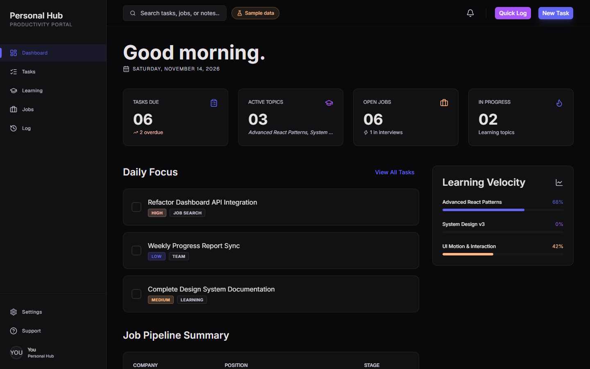
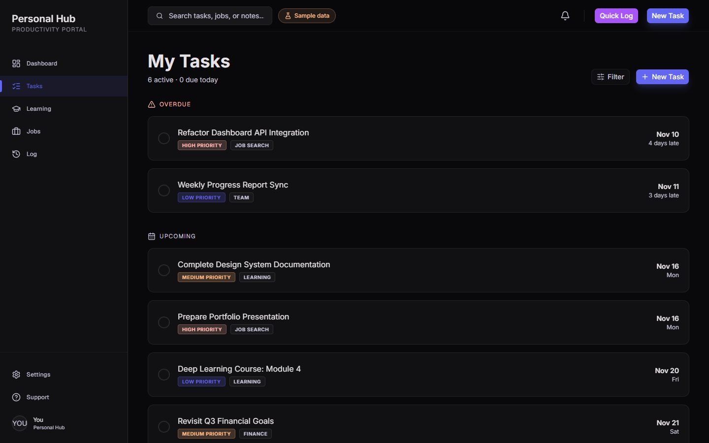
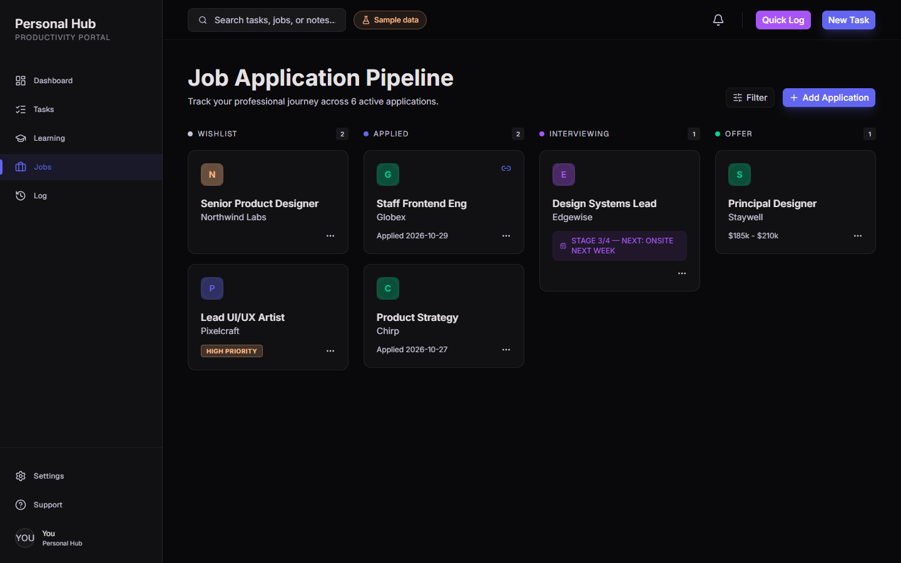
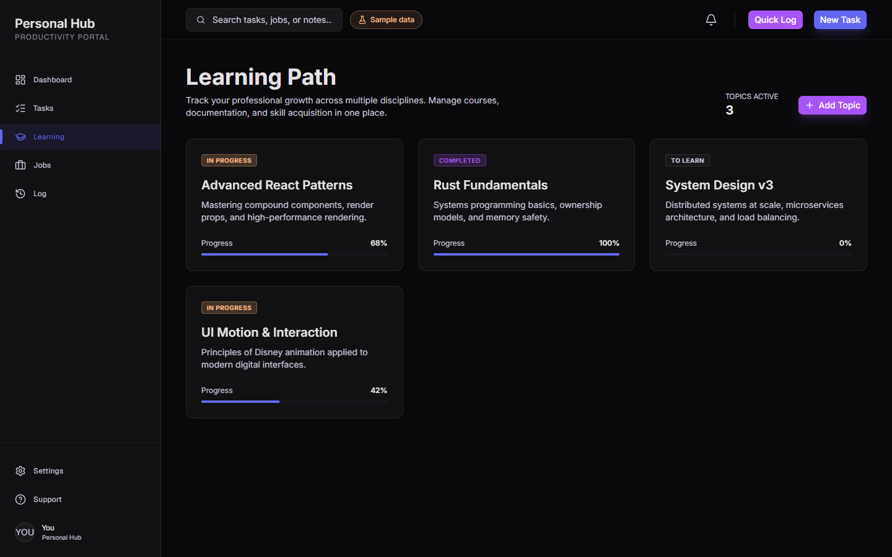
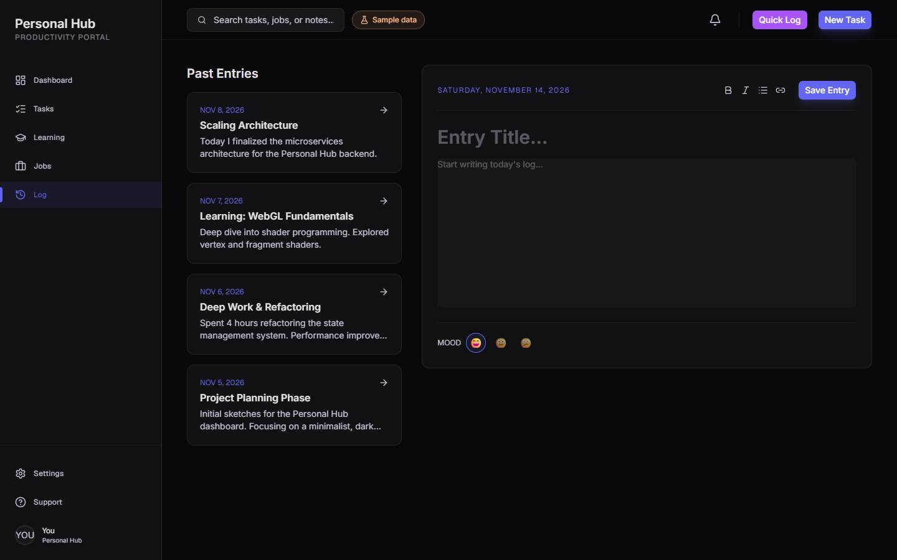
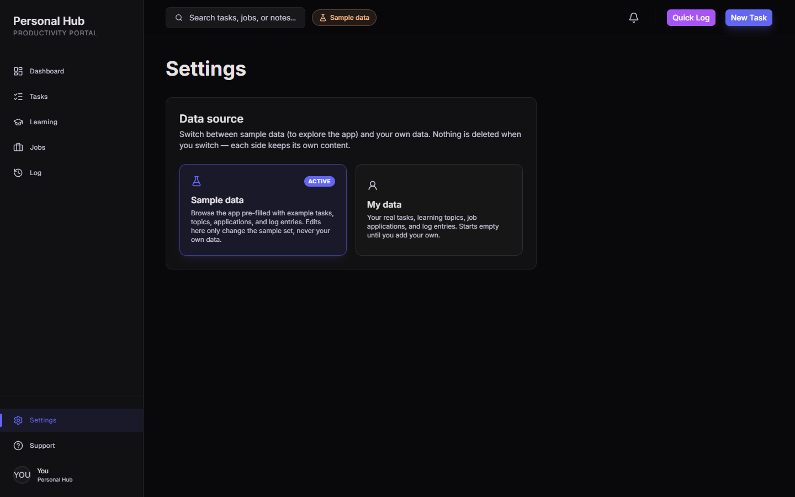

# Personal Hub

A dark, single-user productivity portal that keeps four parts of a working life in one place: **tasks**, a **learning path**, a **job application pipeline** and a **daily log**. It's a React frontend over a small Express API that stores everything in a local JSON file, so you need no database or account to run it.

<p align="center">
  
</p>

## Features

- **Dashboard.** A greeting plus counters (tasks due/overdue, active learning topics, open job applications, topics in progress), "Daily Focus" tasks, learning velocity bars and a job pipeline summary.
- **Tasks.** Priorities (high/medium/low), tags and due dates, with overdue items grouped first and a "days late" counter.
- **Learning path.** Topics with a status (to learn / in progress / completed), a description and a progress percentage.
- **Job pipeline.** A kanban board with the stages *wishlist → applied → interviewing → offer*. Each card carries a high-priority flag, the applied date, a posting link, a salary range and notes.
- **Daily log.** A journal with past entries on the left and an editor with a mood picker on the right.
- **Coming next** (the app is still in development): top-bar quick actions (*Quick Log*, *New Task*), search, notifications and filters are in the UI but not wired up yet.
- **Sample data / my data.** Switch in Settings between a prefilled demo dataset (to explore the app) and your own data. The two are stored side by side, and switching never deletes anything.

<p align="center">
  
  
</p>
<p align="center">
  
  
</p>
<p align="center">
  
</p>

## Stack

An npm workspaces monorepo:

| Package | Stack |
|---|---|
| `web/` | React 18 + TypeScript + Vite, Tailwind CSS v4, shadcn/ui (Base UI), Lucide icons, React Router |
| `server/` | Express 5 + TypeScript (run with `tsx`), JSON file storage |

## Getting started

Requires Node.js **20.19+** or **22.12+** (Vite 7's minimum).

```bash
npm install          # installs both workspaces
npm run dev          # API on http://localhost:4000 + web on http://localhost:5173
```

You can also run the two halves separately:

```bash
npm run dev:server
npm run dev:web
```

Production-style build:

```bash
npm run build        # compiles server/ to server/dist and builds web/ to web/dist
npm start            # runs the compiled API (serve web/dist with any static server, e.g. npm --workspace web run preview)
```

The first time the app reads or saves data, the server creates `server/data/db.json` from `server/data/db.example.json`, starting in **sample data** mode. The sample dates are shifted to the current day when the file is created, so the demo always looks current. The companies in the sample job pipeline are fictional. `db.json` holds your real data and is gitignored.

### Configuration

| Where | Variable | Default | Purpose |
|---|---|---|---|
| `server` | `PORT` | `4000` | API port |
| `server` | `HOST` | `127.0.0.1` | Interface to bind. Keep it on loopback; see [Security](#security) |
| `web/.env` | `VITE_API_URL` | `http://localhost:4000` | Where the frontend calls the API (see `web/.env.example`) |

## API

Each resource has the same CRUD shape, built by one generic router (`server/src/routes/resource.ts`):

| Resource | Base path |
|---|---|
| Tasks | `/api/tasks` |
| Learning topics | `/api/learning` |
| Job applications | `/api/jobs` |
| Log entries | `/api/log` |

The verbs are `GET /`, `POST /`, `PATCH /:id` and `DELETE /:id`.

There are also three standalone endpoints:

- `GET /api/settings` and `PATCH /api/settings` with `{ "mode": "demo" | "live" }` read and switch the active dataset.
- `GET /api/health` is a liveness check.

Request bodies are validated against a per-resource schema (`server/src/validate.ts`). Only known fields are accepted and each one is type-checked; `id` and `createdAt` are set by the server. Links must be `http(s)`. Errors come back as JSON.

Writes to the JSON file are serialized through a single promise chain and written atomically (temp file + rename), so two quick edits can't interleave and a crash can't leave a half-written file.

## Security

Personal Hub is a **local, single-user app** with no login. The API binds to `127.0.0.1` and rejects requests whose `Host` or `Origin` isn't localhost, so other devices on your network and other websites open in your browser can't read or change your data. Don't expose it to a network (no `HOST=0.0.0.0`, tunnels or reverse proxies).

## Project structure

```
server/
  src/index.ts          Express app + route mounting
  src/db.ts             JSON store (demo/live slots, serialized writes, first-run seeding)
  src/validate.ts       request-body schemas (types, lengths, http-only links)
  src/routes/           resource.ts (generic CRUD) + one file per resource + settings
  data/db.example.json  seed data (sample dataset + empty "my data")
web/
  src/pages/            Dashboard, Tasks, Learning, Jobs, Log, Settings
  src/lib/api.ts        typed API client
design/                 the Google Stitch prompt used to explore the visual direction
```

## License

[MIT](LICENSE)
